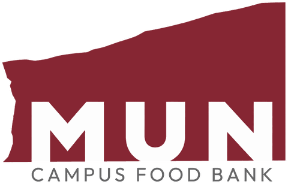

# Campus Food Bank Booking System

[](https://github.com/pperiyasamy-4404/MUN-Campus-Food-Bank/actions/workflows/tests.yml)

A booking system for a university campus food bank. Students book a pickup time online and choose their food. Volunteers pack the bags and hand them over at the counter. A coordinator runs the pickup days and sees weekly totals. The system never stores a student's name, email or ID number.

It was built for the Campus Food Bank at Memorial University of Newfoundland (MUN) in St. John's. **It is a working prototype with made-up data.** It's an independent project, not an official MUN or Campus Food Bank system, and real students don't use it yet.

**Stack:** Python 3.14 · FastAPI · SQLAlchemy 2 · PostgreSQL 18 · Alembic · React 19 · TypeScript · Vite · pytest (574 tests) · Vitest (22 page tests) · GitHub Actions

<p>
  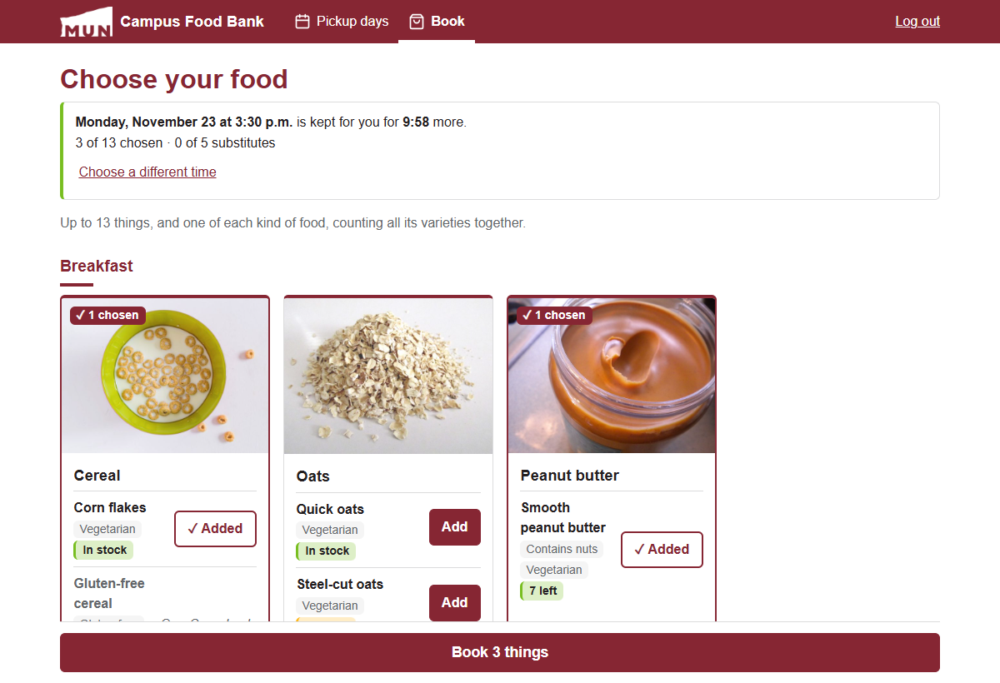
  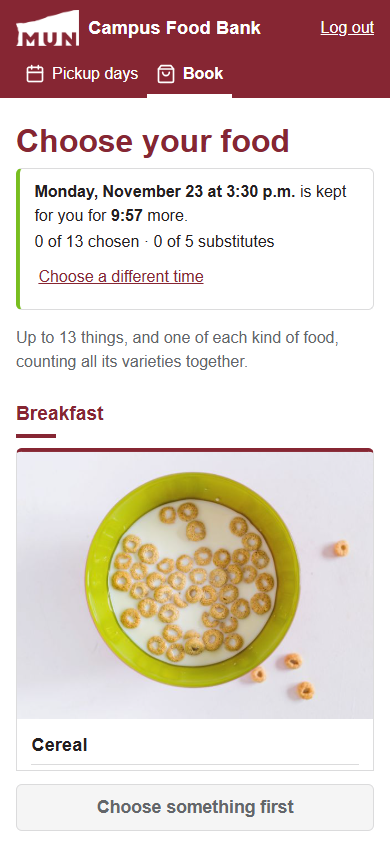
</p>

## Contents

- [What it does](#what-it-does)
- [Screenshots](#screenshots)
- [Rules it enforces](#rules-it-enforces)
- [Privacy by design](#privacy-by-design)
- [Many people at once: locks and a load test](#many-people-at-once-locks-and-a-load-test)
- [Try the demo](#try-the-demo)
- [Full setup](#full-setup)
- [Tests](#tests)
- [Project layout](#project-layout)
- [Design documents](#design-documents)
- [What's not done yet](#whats-not-done-yet)

## What it does

**Students** (on their phone)
- Get an account at the counter. A volunteer checks their MUN card and gives them a one-time setup code. The student then chooses their own password on their phone.
- Pick a 10-minute pickup time. The time is held for 10 minutes while they choose their food, with a countdown.
- Choose up to 13 things from food cards with photos and dietary tags (vegetarian, halal, gluten-free, contains nuts), plus up to 5 substitutes in order, in case something runs out.
- Get a three-character booking code, like `K3P`, to say at the counter. They can cancel until booking closes.

**Volunteers**
- **Packing queue:** bags for today, earliest first. It shows "Sam is packing" so two people don't pack the same bag.
- **Pack a bag:** tick each item as Picked or Out of stock. Substitutes are filled in automatically in the student's order. Any swap goes on a sticky note, like "Sunflower oil → rice". Marking a food out of stock flags every other bag that booked it.
- **Counter:** find the bag by its code, or by MUN card number if the student has no code. Type the number from the card to check it matches, record the extras given, and hand it over. Walk-ins are recorded on the same screen.
- **Stock:** most food is just "In stock" or "Few left". Food worth sharing out exactly, like 6 jars from one donation, gets a number. Any volunteer can add food, photos, categories and tags.
- **Fix a pickup:** after the day is over, change a no-show to picked up or back. Every fix is logged with who made it.

**Coordinators**
- Close a day, or a range of dates, for a holiday or a snowstorm, with a reason students see. Every booking that day is cancelled, and packed food goes back to stock.
- Move one day's booking times, for example if the website was down.
- Change settings such as the pickup gap, item limit, pickup hours and slot size.
- Manage staff accounts. There can be several coordinators.
- See weekly totals only: bags picked up, walk-ins, no-shows and food given out.

**A jobs script** (`python -m app.jobs`, every 15 minutes) makes pickup days a week ahead. It marks bags not collected by 8 pm as no-shows and puts their food back. It also saves weekly totals and then deletes old booking details, and deletes accounts with no pickup for a year.

## Screenshots

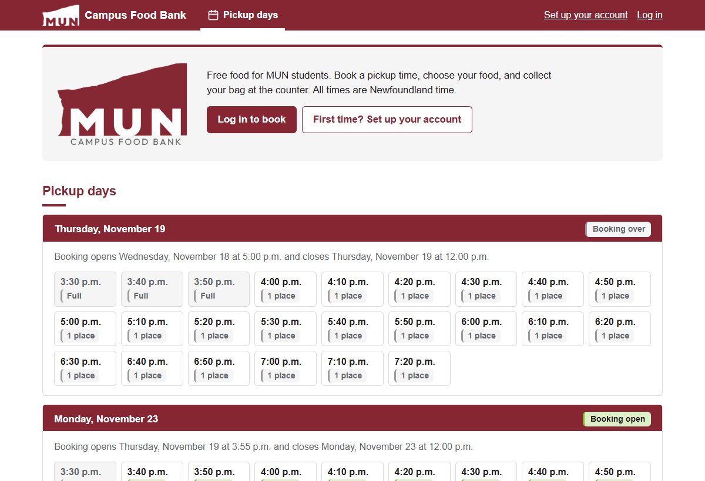

| | |
|---|---|
| 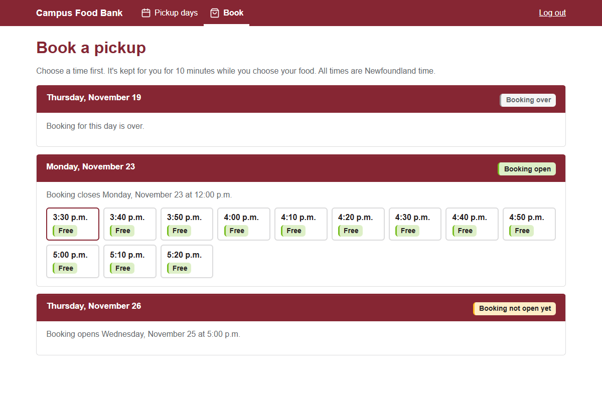 **Student:** pick a time | 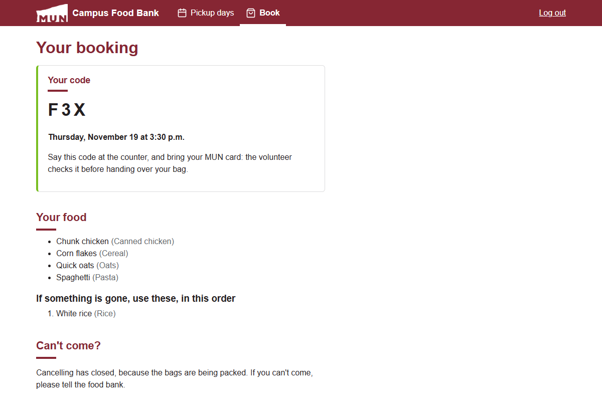 **Student:** the booking and its code |
| 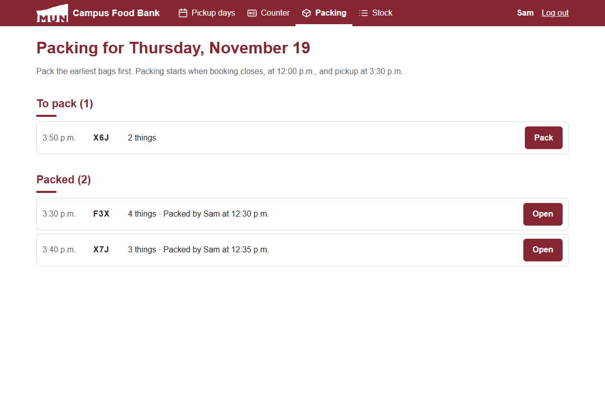 **Volunteer:** packing queue | 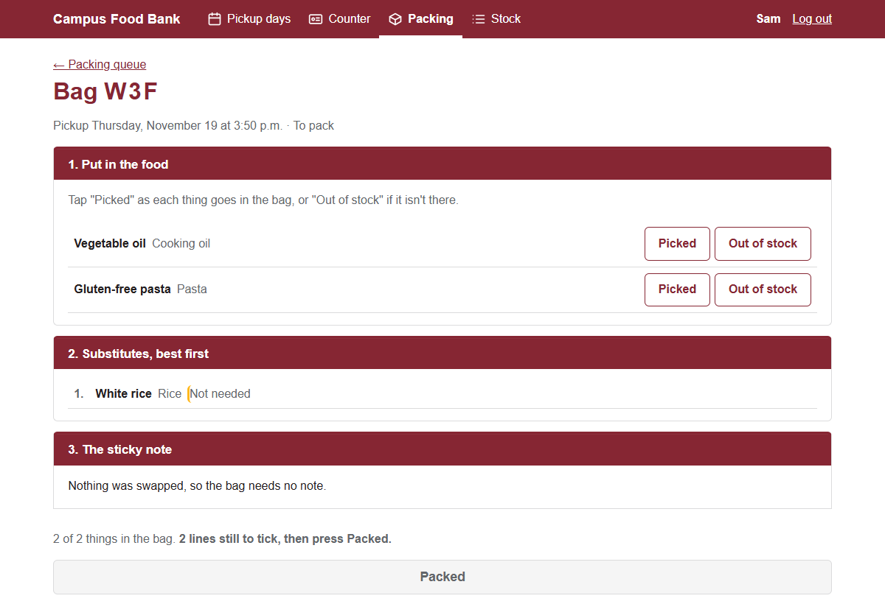 **Volunteer:** pack a bag |
| 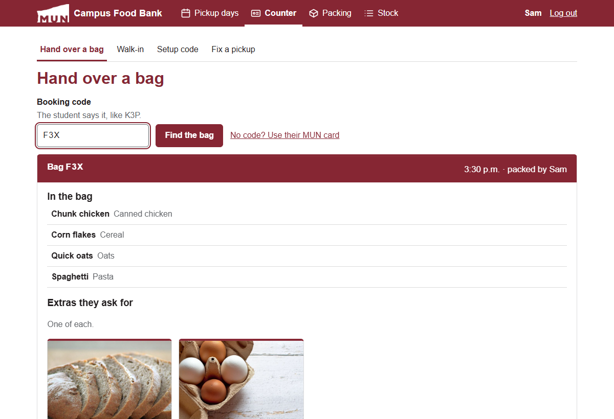 **Volunteer:** the counter | 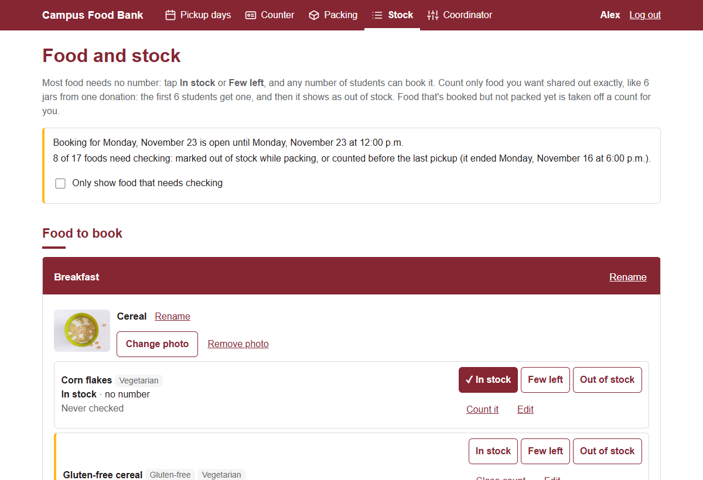 **Volunteer:** stock |
| 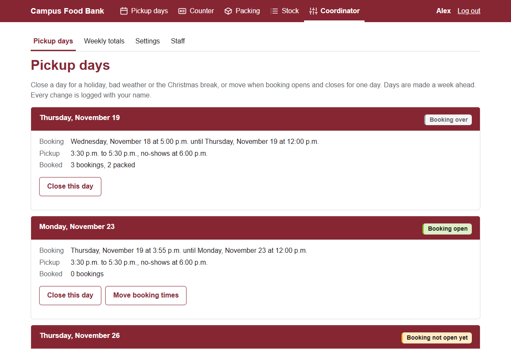 **Coordinator:** pickup days | 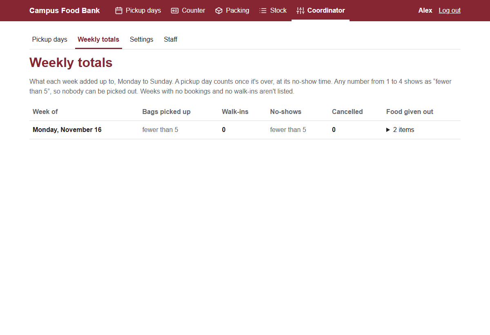 **Coordinator:** weekly totals |

## Rules it enforces

The full list is in [CONSTRAINTS.md](CONSTRAINTS.md), with a number for each rule. The main ones:

- **One pickup every 30 days**, counted in Newfoundland calendar days. Pickups recorded in the food bank's old system count too.
- **At most one upcoming booking per student.** Pressing Book twice makes only one booking.
- **A time never goes over its places**, and **stock never goes below zero**, even when many students book at the same second.
- **Up to 13 things per bag, and one of each kind of food.** For example, one canned chicken, even if there are three kinds.
- **Students get only what they chose.** A substitute is used only if the student listed it, so a student who chose gluten-free pasta never gets regular pasta.
- **A bag is handed over only after a volunteer checks the MUN card** against the booking. No card, no food.
- **Booking opens at 5 pm the day before and closes at 12 pm on the pickup day.** Then packing starts, pickup is 3:30 to 7:30 pm, and bags not collected by 8 pm become no-shows. These times are settings, so the coordinator can change them.
- **A booking can only move forward:** booked → packed → picked up, or cancelled or no-show. Undoing Packed and fixing a no-show are the only ways back, and both are logged.

Most of these rules are checked twice: once in the code, and again by the database itself, with CHECK constraints, unique indexes and foreign keys. The tests check that the database refuses a bad row even when the code is skipped, and that it names the rule that refused it.

## Privacy by design

- **The MUN ID number is never stored.** Only a keyed hash (HMAC-SHA256) is kept, and the key lives outside the database. A stolen copy of the database alone can't be turned back into ID numbers. A database rule refuses anything that isn't a 64-character hash, so a raw number can't be saved by mistake.
- **No names, emails or phone numbers** for students, anywhere, including logs. Volunteer pages never show an ID number: only a booking code and food. At the counter, the volunteer types the number from the card, and the system only answers whether it matches.
- **The ID number never appears in a web address, a log or an error message.** A test checks this: it searches every response, every log line (including SQL) and every database row.
- **Passwords** are hashed with argon2. Wrong passwords are slowed down per ID number instead of locking the account, so nobody can lock a student out on purpose.
- **Login** uses a session cookie that is HttpOnly, Secure and SameSite=Strict, with no tokens in the browser's storage.
- **Safety headers on every answer:** a Content Security Policy (scripts, styles and photos from this site only), no framing by other sites, no guessing file types, and HTTPS remembered for a year.
- **Server errors are logged without what was sent.** A crash writes the address and the error to `errors.log` (1 MB files, the last 5 kept), never the request's body, so never an ID number or a password. The person sees "Something went wrong on our side", not the error. A test sends an ID number to a failing address and searches the log for it.
- **The API docs page is off** unless `API_DOCS=true` is set, so the live site doesn't list every address.
- **Booking details are deleted after 90 days.** Each day's totals are saved first. On the weekly totals page, any number from 1 to 4 shows as "fewer than 5", so nobody can be picked out. The server hides the real number, so it never reaches the browser.

## Many people at once: locks and a load test

At 5 pm, hundreds of students may press Book at the same second. Every place where two people could take the last of something uses a row lock (`SELECT … FOR UPDATE`), always in the same order: student, slot, booking, food. Examples are the last place in a time, the last tin, and two volunteers handing over the same bag. Each race has a test that opens two database connections at once. Each of those tests was checked to fail with its lock removed.

To check the whole system under real load, [backend/loadtest](backend/loadtest/run.py) plays one pickup week against the real server, with 360 students and 6 volunteers:

1. **Login rush:** 370 people log in at the same moment.
2. **Booking rush:** booking opens and everyone books at once. Some press Book twice, some use two phones, some cancel, and a coordinator closes Thursday for a snowstorm in the middle.
3. **Packing:** six volunteers pack every bag at once. A few bags are packed by two volunteers at the same moment, on purpose.
4. **Counter:** everyone arrives at once at three counters, with wrong cards, the same code typed twice, and walk-ins.
5. **Jobs:** the jobs script runs twice at the same moment while volunteers use the pages.
6. **A normal hour:** people browsing, to measure everyday speed.

After each phase it checks every database rule, and that the database matches what each person was told on screen.

**What it found:** the first run froze the whole server at 5 pm. The routes run on FastAPI's 40 worker threads, but there were only 15 database connections. A request holds its connection until FastAPI has checked its answer, and that check needs a free thread too. So 40 requests held every thread while waiting for a connection, and the 15 with connections waited for a thread. Nobody could move.

**The fix** ([backend/app/door.py](backend/app/door.py)) is a queue at the door, which lets only as many requests in as there are database connections. The rest wait on the event loop, which uses no thread and no connection. The fix also allows at most 4 password checks at once, because each argon2 check needs 64 MB of memory.

| | Before the fix | After the fix |
|---|---|---|
| Logins that worked (370 at once) | 0 of 370 | 370 of 370 (slowest 13.5 s) |
| Booking rush | stuck for 15 minutes, 0 bookings | every place filled in 27.5 s |
| Server errors | 1,378 | 0 |
| Peak server memory | 1.1 GB | 0.4 GB |
| Database rules after every phase | held | held |

With 20 places per time, 238 students booked in the rush. Every student who was told "booked" has a booking, and nobody else does. On a single CPU core everything stayed correct, but logins took up to 87 seconds, so the live server needs at least 2 cores. The full results are in [backend/loadtest/results](backend/loadtest/results), and [load-test.html](load-test.html) explains them.

**Running it with 4 server processes found two more bugs**, both races that 1 process had been lucky to miss, and both now fixed with a test each:

- **A deadlock between bookings with substitutes.** Saving a substitute makes PostgreSQL lock that food lightly, and those locks were taken after the booked food, out of order. Ana (oats, with peanut butter as a substitute) and Ben (peanut butter, with oats as a substitute) each held one and waited for the other. Book now locks every food, booked or substitute, lowest id first. Before the fix, 57 requests failed with a 500. After it, none did.
- **One student holding two times from two phones at once** saved two holds, and the second broke "one hold per student". Holding a time now locks the student first, like booking does.

The new error log is what traced both. With 4 processes, the full week then ran with no server errors and every rule kept. One thing is left to check on the real host: on this Windows laptop, in some 4-process runs a quarter of the logins got no answer for 2 minutes, which never happens with 1 process. It looks like how processes share connections on Windows, and a live server would run on Linux.

## Try the demo

You need **Python 3.14**, **Node.js 24** and **PostgreSQL 18**, with the databases set up as in [Full setup](#full-setup), steps 1 to 3.

```powershell
cd frontend
npm install
npm run build

cd ../backend
.venv\Scripts\python -m app.demo
```

Then open http://localhost:8000. The demo empties the **test** database and fills it with a pickup afternoon. The server's clock is set to the next Thursday at 4 pm, St. John's time, so packing, the counter and booking all have something on them. The working database is never touched.

Every account's password is `blue kettle on the stove`.

| Log in as | Who | What to try |
|---|---|---|
| `Alex` (Staff tab) | coordinator | Close a day, settings, weekly totals, staff |
| `Sam` (Staff tab) | volunteer | Pack the bag still to pack, then hand over 202300001's bag with card `202300001` (the demo prints each bag's code when it starts) |
| `202300005` | student | Book next Monday |
| `202300001` | student | See a packed booking and its code |
| `202300004` | student | Picked up last Monday, so can't book again for 30 days |

Press Ctrl+C to stop it. Run it again for a fresh start.

## Full setup

The commands are for Windows (PowerShell). On macOS or Linux, use `.venv/bin/python` in place of `.venv\Scripts\python`.

**1. Databases.** As the PostgreSQL admin, make a login for the app with no admin powers, and two databases it owns:

```sql
CREATE ROLE foodbank_app LOGIN PASSWORD 'choose-a-password';
CREATE DATABASE campus_food_bank      OWNER foodbank_app;
CREATE DATABASE campus_food_bank_test OWNER foodbank_app;
```

**2. Backend.**

```powershell
cd backend
py -3.14 -m venv .venv
.venv\Scripts\python -m pip install -r requirements.txt
copy .env.example .env
```

Fill in `backend/.env`: the password in both database URLs, and a `SECRET_KEY`. Make the key with:

```powershell
.venv\Scripts\python -c "import secrets; print(secrets.token_hex(32))"
```

Keep the key safe and never change it. Without it, no MUN card can be matched to its account.

**3. Tables.**

```powershell
.venv\Scripts\python -m alembic upgrade head
```

**4. Sample food and pickup days** (into the empty working database), and the first coordinator:

```powershell
.venv\Scripts\python -m app.sample_data
.venv\Scripts\python -m app.first_coordinator Alex
```

The second command prints a setup code. Open `/staff/setup`, type the username and the code, and choose a password.

**5. Run it.** You need two terminals:

```powershell
# terminal 1, in backend/
.venv\Scripts\python -m uvicorn app.main:app --reload

# terminal 2, in frontend/
npm install
npm run dev
```

Open http://localhost:5173. Vite sends `/api` to the server on port 8000, so the whole site is on one address and the SameSite cookie works without CORS.

**6. Jobs.** In production, the server's scheduler (for example cron) must run this every 15 minutes:

```powershell
.venv\Scripts\python -m app.jobs
```

It's safe to run twice at once, catches up after a missed run, and exits with code 1 if a job fails, so monitoring can raise an alert. On this computer it's run by hand. [backend/run_jobs.cmd](backend/run_jobs.cmd) runs it once and adds the result to `jobs.log`.

## Tests

```powershell
cd backend
.venv\Scripts\python -m pytest
```

574 tests, all against a real PostgreSQL test database. It's rebuilt from the migrations on every run, and each test's changes are rolled back afterwards. They take about a minute. The tests cover:

- **every rule** in CONSTRAINTS.md, through the service functions and through the HTTP API
- **database rules:** a bad row is refused by the database itself, and the test checks the name of the constraint that refused it
- **races:** two real database connections at once, for example the last place in a time, the last tin, a hand-over a minute before the no-show job runs, and a coordinator closing a day while a student presses Book
- **time:** Newfoundland's half-hour time zone, summer time, and the day the clocks go back
- **privacy:** the ID number is searched for in every response, log and table
- **migrations:** they match the table classes, and can be undone and run again
- **the live server:** safety headers, the API docs page off by default, and server errors logged without what was sent

The pages have 22 tests of their own (Vitest), for the rules they check before asking the server: what still needs a tap before Packed, one of each item at the counter, the old-system question, what needs checking on the Stock page, and Newfoundland times shown right wherever the browser is:

```powershell
cd frontend
npm test
```

**GitHub Actions** runs both sets of tests, plus the lint and the build, on every push ([.github/workflows/tests.yml](.github/workflows/tests.yml)), with a real PostgreSQL 18 and a new secret key for each run.

The load test empties the test database too:

```powershell
.venv\Scripts\python -m loadtest.run                  # 300 + 60 students, 1 place per time
.venv\Scripts\python -m loadtest.run --capacity 20    # 20 places per time
.venv\Scripts\python -m loadtest.run --one-core       # like a small 1-CPU cloud server
.venv\Scripts\python -m loadtest.run --capacity 20 --workers 4   # 4 server processes
```

## Project layout

```
.github/workflows/   the tests on every push
backend/
  app/
    main.py          FastAPI app, error handlers, the queue at the door
    models/          24 tables (SQLAlchemy), with their CHECK and unique rules
    services/        the rules: booking, packing, counter, no-shows, stock, totals...
    routes/          the HTTP API, thin, calls the services
    security/        keyed hashes, argon2, sessions, setup codes, wrong-try limits
    jobs.py          the every-15-minutes script
    demo.py          the one-command demo
  migrations/        Alembic migrations
  tests/             pytest
  loadtest/          the pickup-week load test and its results
frontend/
  src/pages/         one file per page (Book, ChooseFood, Packing, PackBag, HandOver...)
  src/styles/        colour and type tokens
```

## Design documents

The rules were agreed before any code was written, and every choice is written down with its reason:

- [CONSTRAINTS.md](CONSTRAINTS.md): every rule, numbered (P1 to P13 for privacy, S for slots, U for substitutes...), plus the settings, known issues and what's not built
- [DECISIONS.md](DECISIONS.md): a dated log of each decision, why it was made, and what else was considered
- Plain-English explainer pages, one for each build step: [project-so-far.html](project-so-far.html) (start here), [tech-and-stack.html](tech-and-stack.html), [tables.html](tables.html), [accounts.html](accounts.html), [stock.html](stock.html), [booking.html](booking.html), [packing.html](packing.html), [counter.html](counter.html), [jobs.html](jobs.html), [coordinator.html](coordinator.html), [what-could-go-wrong.html](what-could-go-wrong.html), [load-test.html](load-test.html)

**Accessibility:** automatic axe checks (WCAG 2.1 AA) pass on every page. Booking works with the keyboard alone, and every page fits a 320-pixel-wide screen.

## What's not done yet

**Before real students use it:**
- Hosting on a cloud server with at least 2 CPU cores, and the cloud's own database backups
- `SECRET_KEY` kept in the cloud's secrets setting, apart from the database
- The scheduler set up to run the jobs script every 15 minutes
- Agreement from the Campus Food Bank on the open questions in [CONSTRAINTS.md](CONSTRAINTS.md#to-ask-the-campus-food-bank)

**Not planned for this version:** reminders by email or text, families, picking up for someone else, other campuses, and other languages.
